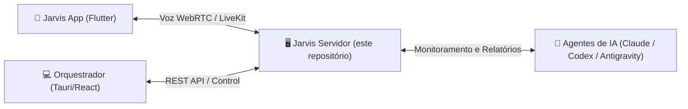

# Jarvis Servidor · Backend & Voice AI Agent

Serviço central de inteligência artificial em tempo real, controle de dispositivos e automação do ecossistema JARVIS. Baseado no framework **LiveKit Agents** e em modelos de linguagem avançados (Gemini / Claude / GPT), o servidor é responsável pelo processamento de voz com baixa latência, execução de tarefas automatizadas e integração com assistentes de código.

---

## 🌐 O Ecossistema Integrado

O ecossistema JARVIS é dividido em três componentes:



1. **[Jarvis Servidor](.) (este repositório):** Agente de voz em tempo real, API de controle de sessões, integração com automações n8n e leitura de status dos agentes de programação.
2. **[Jarvis App](../jarvis-app):** Aplicativo para smartphone e desktop com visualização de formas de onda de áudio, monitoramento de cotas de IA e notificações em segundo plano.
3. **[Orquestrador](../orquestrador):** Interface desktop para indexação vetorial (RAG), templates de engenharia de prompt e dashboards analíticos.

---

## ✨ Principais Funcionalidades

- **Voz Bidirecional em Tempo Real:** Conversação natural com detecção de fala (STT), geração de áudio neural expressivo (TTS) e interrupções fluidas através do LiveKit.
- **Leitura de Relatórios de IA:** Capacidade de responder a comandos como *"Jarvis, qual o último relatório do Claude/Codex/Antigravity?"*, sintetizando os últimos outputs das ferramentas de desenvolvimento.
- **Notificação Silenciosa de Conclusão:** Emite avisos discretos para o app quando tarefas longas de desenvolvimento forem finalizadas pelos agentes de IA.
- **API de Controle Always-On:** Gerencia o ciclo de vida do agente por demanda, reduzindo consumo de recursos no servidor.
- **Pesquisa na Web Falada:** Integração com APIs de busca para consulta de dados em tempo real durante a conversa.
- **Deploy Resiliente via Systemd:** Configuração de serviços (`jarvis-agent.service` e `jarvis-control.service`) com rotinas automáticas de rollback e testes de fumaça (*smoke tests*).

---

## 🛠️ Tecnologias Utilizadas

- **Linguagem:** Python 3.12+
- **Voz & WebRTC:** [LiveKit Agents](https://docs.livekit.io/agents/), LiveKit Cloud / Server
- **Modelos de IA:** Google Gemini Live API, Deepgram STT, ElevenLabs / Cartesia TTS
- **Servidor Web:** aiohttp, FastAPI, Uvicorn
- **Gerenciador de Pacotes:** `uv`
- **Infraestrutura:** Linux Systemd, Polkit, Docker, n8n

---

## 📂 Estrutura do Repositório

```text
jarvis-servidor/
├── src/                        # Código fonte do servidor
│   ├── agent.py                # Ponto de entrada do agente de voz LiveKit
│   ├── jarvis_control/         # API de controle de sessões, dispositivos e status
│   └── jarvis_desktop/         # Helper e daemon para interação com PC Windows
├── tests/                      # Bateria de testes unitários e de integração
├── deploy/                     # Scripts de implantação, systemd units e polkit
│   ├── systemd/                # Definições dos serviços jarvis-agent e jarvis-control
│   ├── deploy.sh               # Script de deploy contínuo com testes e verificação
│   └── smoke_session.py        # Teste de fumaça de conexão de áudio em tempo real
├── pyproject.toml              # Metadados e dependências Python
├── scenarios.yaml              # Cenários de validação e testes comportamentais
└── .env.example                # Modelo de variáveis de ambiente
```

---

## 🚀 Como Executar

### 1. Pré-requisitos
Instale o gerenciador de pacotes moderno [uv](https://github.com/astral-sh/uv):
```bash
pip install uv
```

### 2. Configurar o Ambiente
Copie o arquivo de exemplo e insira suas credenciais:
```bash
cp .env.example .env
```
Preencha no `.env`:
- `LIVEKIT_URL`: URL do seu servidor ou projeto LiveKit Cloud (ex: `wss://seu-projeto.livekit.cloud`).
- `LIVEKIT_API_KEY`: Chave de API do LiveKit.
- `LIVEKIT_API_SECRET`: Segredo de API do LiveKit.
- `GOOGLE_API_KEY`: Chave de API do Google Gemini.

### 3. Instalar Dependências e Executar Testes
```bash
uv sync
uv run pytest
```

### 4. Iniciar o Agente de Voz
```bash
uv run python src/agent.py dev
```

### 5. Iniciar a API de Controle
```bash
uv run python -m jarvis_control serve
```
